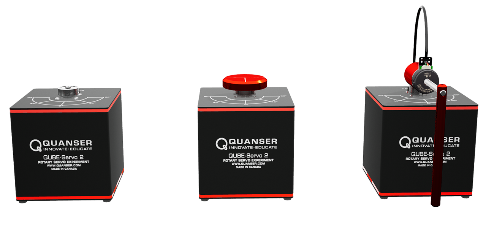
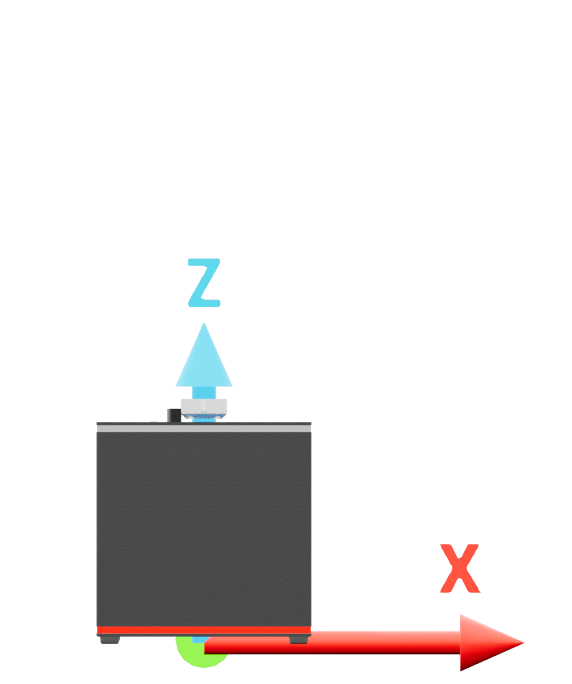
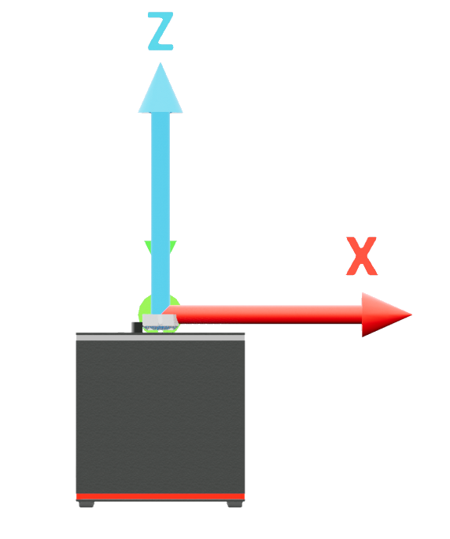

.. _Qube2:

*****************
Qube-Servo 2
*****************

.. _qube2Description:

Description
============

The Qube-Servo 2 is considered an "actor" in Quanser Interactive Labs.
It can be spawned in the workspaces that support it and controlled through its
HIL ports. See :ref:`spawnableactorsWorkspaces` for the workspaces where this
actor is available.

.. _qube2Library:

Library
========

.. autoclass:: qvl.qube2.QLabsQube2

.. _qube2Constants:

Constants
============

.. autoattribute:: qvl.qube2.QLabsQube2.ID_QUBE2

.. _qube2MemberVars:

Member Variables
==================

.. autoattribute:: qvl.qube2.QLabsQube2.actorNumber

.. _qube2ParentMethods:

Parent Class (actor.py) Methods
================================

.. automethod:: qvl.qube2.QLabsQube2.__init__
.. automethod:: qvl.qube2.QLabsQube2.spawn
.. automethod:: qvl.qube2.QLabsQube2.spawn_degrees
.. automethod:: qvl.qube2.QLabsQube2.spawn_id
.. automethod:: qvl.qube2.QLabsQube2.spawn_id_degrees
.. automethod:: qvl.qube2.QLabsQube2.spawn_id_and_parent_with_relative_transform
.. automethod:: qvl.qube2.QLabsQube2.spawn_id_and_parent_with_relative_transform_degrees
.. automethod:: qvl.qube2.QLabsQube2.destroy
.. automethod:: qvl.qube2.QLabsQube2.destroy_all_actors_of_class
.. automethod:: qvl.qube2.QLabsQube2.get_world_transform
.. automethod:: qvl.qube2.QLabsQube2.get_world_transform_degrees
.. automethod:: qvl.qube2.QLabsQube2.ping
.. automethod:: qvl.qube2.QLabsQube2.parent_with_relative_transform
.. automethod:: qvl.qube2.QLabsQube2.parent_with_relative_transform_degrees
.. automethod:: qvl.qube2.QLabsQube2.parent_with_current_world_transform
.. automethod:: qvl.qube2.QLabsQube2.parent_break
.. automethod:: qvl.qube2.QLabsQube2.set_custom_properties
.. automethod:: qvl.qube2.QLabsQube2.get_custom_properties

.. _qube2Config:

Configurations
================

There are three configurations (0-2) for the Qube-Servo 2 actor class.

    * 0 - Hub only
    * 1 - Inertial disc
    * 2 - Pendulum

.. _qube2Connect:

Connection Points
====================

.. table::
    :widths: 20, 11, 11, 11, 53
    :align: center

    =============================== ====================== ============ ====================================================== ===========
    Image (Click for enlarged view) Reference Frame Number Parent Frame Relative Transform to Parent (Location, Rotation)      Description
    =============================== ====================== ============ ====================================================== ===========
    |conn0|                         0                                                                                          The base frame is located on the center between the four feet.
    |conn1|                         1                      0            [0,0,0.116] [0,0,0]                                    Top of the hub mounting surface.
    =============================== ====================== ============ ====================================================== ===========

